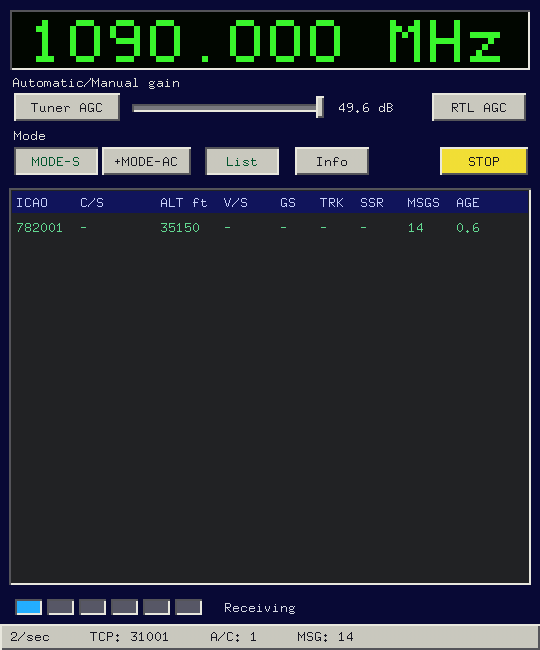

# RTL1090X

RTL1090X 是为斐讯 N1 / Armbian 开发的 1090 MHz 接收控制台。C++17 和 X11 绘制桌面界面，独立运行的 Debian dump1090-mutability 进程负责 RTL-SDR 采样、Mode S 解调和 ADS-B 解码。



## 编译和安装

在 Debian 12 arm64 上运行：

```sh
sudo apt-get install --no-install-recommends g++ make libx11-dev libjson-c-dev dump1090-mutability
make
sudo make install
rtl1090x
```

用普通桌面用户运行，需具备 RTL-SDR USB 访问权限。如果安装软件包时询问是否自动启动 dump1090 服务，选择否，让桌面程序按需打开接收棒。其他 SDR 应用须先释放同一设备。

## 操作

点击 START 或按空格开始接收。STOP 或关闭窗口会停止本实例的解码器。启动参数 `--start` 可直接开始接收。停止时可以点击增益条选择请求增益（硬件取最近支持档位），切换 Tuner AGC 或 RTL AGC。默认请求 49.6 dB。`+MODE-AC` 启用后端的附加 A/C 解码，MODE-S 恢复标准模式。列表显示后端提供的飞机记录，缺失字段显示短横线，滚轮用于翻页。

蓝色指示灯对应每秒 1、10、20、40、80、120 条消息。接收时本机可连接 Beast TCP 31001 和 SBS/BaseStation TCP 30003。Info 显示接收状态。如接收器退出，可从终端启动查看后端错误。

本版实现接收控制、列表和本机 TCP 输出。待实现的功能见 [TODO](TODO.md)。界面依据 [RTL1090 公开操作说明](https://rtl1090.com/installation-manual-2/) 和经典接收面板布局独立编写。项目与 Jetvision 无隶属关系。

## 许可

本仓库原创代码采用 MIT 许可。dump1090-mutability 由系统软件包单独提供，遵循其自身许可证。
